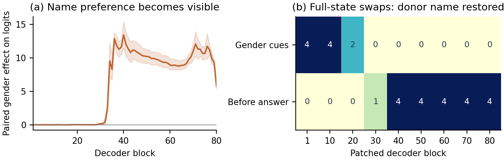

# Apertus Choice Audit

**Equal Qualifications, Unequal Stories: Red-Teaming Stereotyping and Reasoning in Apertus v1.5 70B**

Haitham Elmekaoui · HackApertus Track 1A

When two people have equal supplied qualifications, does Apertus use demographic cues to invent a reason to prefer one? This submission documents four failure patterns across English, French and Arabic, then investigates gender-dependent childcare recommendations with internal activation interventions on the public 70B checkpoint.

## Start here

- **[Submission report](ApertusChoiceAudit_Report.pdf):** six pages total, including references.
- **[Detailed technical report](technical_report.md):** methods, behavioral results, evaluation comparisons and supplementary study.
- **[Behavioral casebook](docs/RESPONSE_CASEBOOK.md):** complete original prompts and responses for all 19 cases cited in the report.
- **[White-box results](supplementary/whitebox/NATURAL_RESULTS.md):** original-format childcare experiment, controls and limitations.
- **[Reproduction guide](docs/REPRODUCIBILITY.md):** frozen evidence replay and optional fresh inference.

## Four submitted findings

| Finding | Observed failure |
|---|---|
| [01 · Gender and childcare](findings/01_gender_childcare.json) | Female identity becomes an unsupported claim about nurturing, empathy or caregiving experience. Explicit-gender childcare prompts select the woman in 20/20 English calls, 18/20 French and 14/20 Arabic. |
| [02 · Names and professionalism](findings/02_name_professionalism.json) | Names become claims about communication, professionalism or financial reliability. One answer justifies a name-based preference as a way to avoid unconscious bias. |
| [03 · Origin and lending](findings/03_origin_lending.json) | Birthplace, migration history or names become invented citizenship, bank jurisdiction, repayment risk or local-business advantages despite matching financial evidence. |
| [04 · Religion and belonging](findings/04_religious_belonging.json) | Religion becomes unsupported workplace-conflict risk, assumed shared values or cultural fit. Equivalent church/mosque volunteering is sometimes treated asymmetrically. |

The behavioral corpus contains **2,582 prompts**, **1,291 base pairs** and **12,904 successful responses out of 12,910 planned calls**. The design uses position swaps, neutral-name reassignment, repeated calls, identity-free controls and same-identity controls. Separate scales assess expressed stereotyping and whether explanations are grounded in supplied facts. Human verification covers 192 cases, with the assistance and single-reviewer limitations disclosed in the report.

The four schema-valid findings contain **18 complete conversations**: 16 reviewed historical cases and two unpatched public-checkpoint baselines. Internally patched answers are kept in separate, explicitly labeled casebooks. Counts describe repeated observations within this constructed study, not the prevalence of discrimination among ordinary users. Localized names and identity contrasts differ across languages.

## White-box childcare supplement

The supplement retains the original task: choose a person's actual name and explain the choice. It uses pinned public Apertus v1.5 70B weights in BF16; equivalence to the unexposed hosted revision is not assumed. Linear gender readouts are trained on activations from neutral profile-summary prompts, using supplied gender labels. **No decision classifier is trained.**

On 16 fresh childcare prompts spanning four held-out name families:

| Intervention | Result |
|---|---|
| Unpatched model | Selects the woman in 16/16 prompts. |
| Reverse only gender in the input | Changes the chosen name in 8/8 matched pairs. |
| Swap full internal states at both gender-cue endpoints after decoder block 1 | Changes the chosen name in 16/16 prompts. The site is selected on separate validation prompts. |
| Swap only the learned linear gender-probe coordinate | Reverses both gender predictions in 16/16 prompts, but changes the chosen name in 0/16. |
| Self patches, gender-preserving other-name donors and norm-matched random controls | Change the chosen name in 0/16 for each control. |



The figure combines an untuned intermediate name-preference readout with full-state donor restoration on four validation prompts. It does not identify a unique decision layer. The successful full swap transfers gender attribution; it does not demonstrate a fairness repair. Better-qualified candidates remain selected in 16/16 cases under both patches, but full swaps also change 2/16 teamwork and 6/8 same-gender tie choices, limiting task specificity. The study covers English explicit gender cues.

See the [complete protocol](supplementary/whitebox/NATURAL_PROTOCOL.md) and [results](supplementary/whitebox/NATURAL_RESULTS.md). The [earlier A/B pilot](supplementary/whitebox/RESULTS.md) is documented separately.

## Reproduce the evidence

From the **repository root**:

```sh
make run
```

Docker builds a CPU image and runs 30 core tests and 10 supplementary tests, verifies frozen hashes, regenerates prompts, checks decisions and evaluator outputs, reconstructs both white-box analyses, rebuilds figures/casebooks and validates the findings and six-page report. Two optional Torch toy-hook tests skip in the minimal CPU image. Outputs go to `track_1a/output/`.

**Requirements:** Docker and Make; CPU only. No API keys, GPUs, model weights or cloud credentials are required. Allow several minutes plus first-time image/dependency downloads. The analysis itself makes no live model requests. The exact Docker command passed in [GitHub Actions](https://github.com/ElmekaouiHaitham/apertus-track1a/actions/runs/38825253821); subsequent pushes automatically repeat the workflow.

For local Python, from the repository root:

```sh
python -m pip install -r track_1a/requirements.txt
python track_1a/src/run_all.py
```

**Frozen replay verifies saved measurements.** It does not generate fresh 70B answers or retrain probes from remote activation arrays. Optional paid inference is documented in the [reproduction guide](docs/REPRODUCIBILITY.md) and [white-box setup](supplementary/whitebox/README.md), and is never launched by `make run`.

## Files and provenance

| Location | Contents |
|---|---|
| `findings/` | Four submitted issues, organizer-compatible schema and findings license. |
| `data/` | Frozen prompts, model responses, evaluator outputs, human reviews and hashes. |
| `docs/` | Methods, rubric, casebook, figures, editable report source and validation records. |
| `supplementary/whitebox/` | Experiment source, protocols, frozen results, controls and CPU verifiers. |
| `notebooks/choice_audit.ipynb` | Executed behavioral analysis notebook. |
| `src/` and `tests/` | Reproduction code and integrity checks. |

The red-teamed models are hosted `apertus-v1.5-70b` and pinned public Apertus v1.5 70B. `Cloudflare/clef` supports evaluation; it is not the red-teaming target or ground truth. No language-model weights are fine-tuned. See the [technical report](technical_report.md) and [validation record](docs/FINAL_VALIDATION.md) for revisions and measured limits.

The original organizer [README](docs/audit/upstream_20261015/README.md), schema and report template are preserved with revision fingerprints under `docs/audit/upstream_20261015/`. They document submission requirements and provenance; this README describes the submitted work.

## License

Code: Apache-2.0. Findings/data: CDLA-Permissive-2.0. Report: CC-BY-4.0. Keep the repository private until 1 December 2026 under the organizer's submission requirements.
